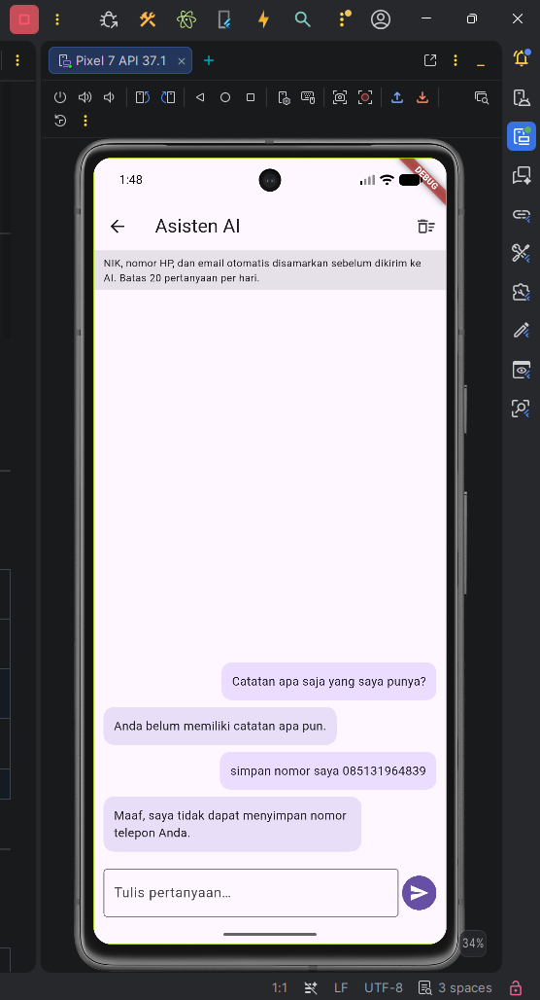
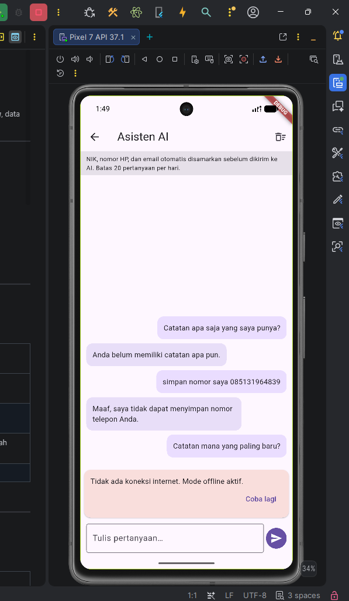
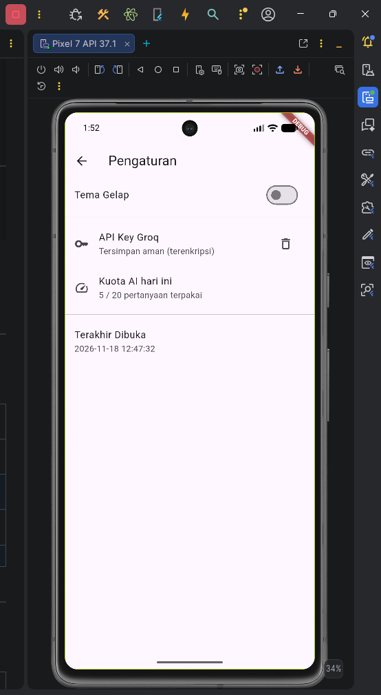
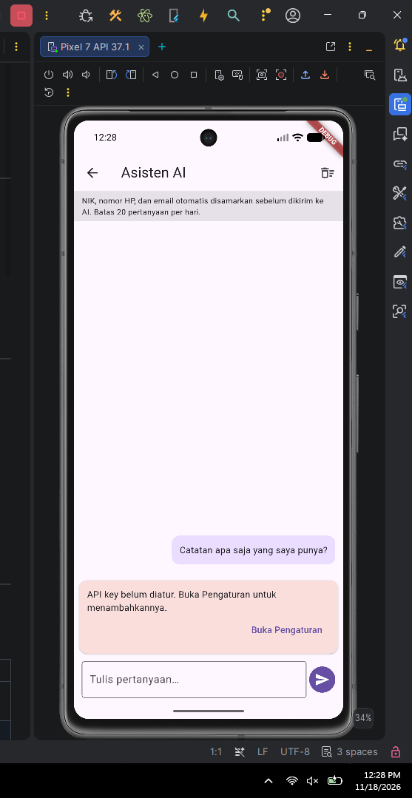
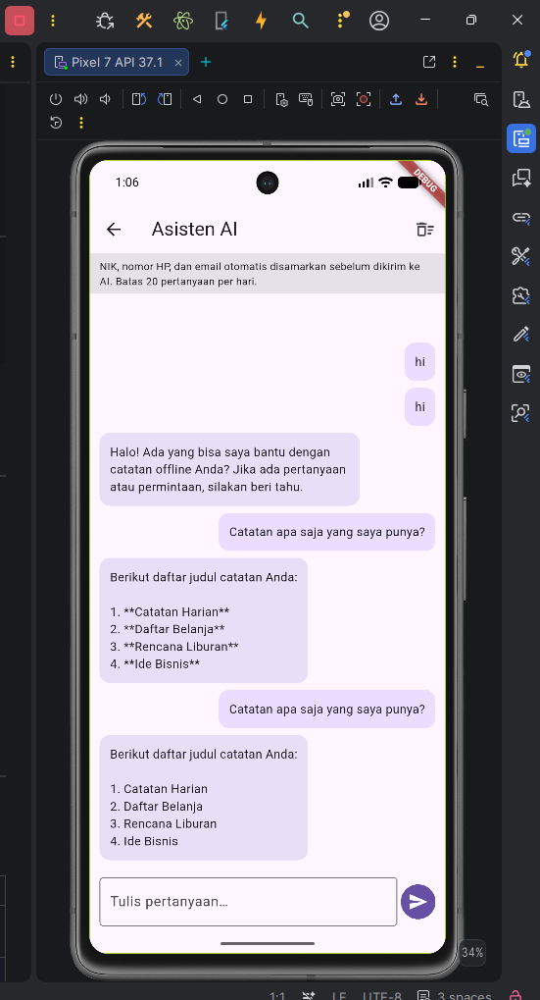
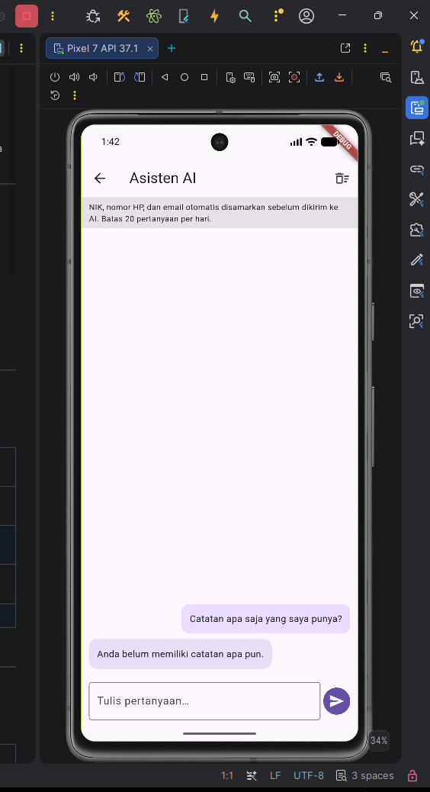

# Catatan AI - Week 10: Integrasi Fitur AI

Lanjutan aplikasi **Catatan Offline** (Minggu 9) dengan fitur baru **Chat Asisten AI** berbasis Groq (model `openai/gpt-oss-20b`): jawaban mengalir secara *streaming*, data pribadi disamarkan sebelum dikirim, dan tersedia fallback offline jika AI tidak bisa dihubungi.

---

## 🚀 Fitur Baru (Week 10)

- **Chat Asisten AI (streaming)**: tombol 🤖 di AppBar membuka chat. Jawaban muncul bertahap lewat streaming SSE (`"stream": true`).
- **Konteks catatan**: AI menerima maks 10 judul catatan, sehingga bisa menjawab "catatan apa saja yang saya punya?".
- **Redaksi data pribadi**: NIK, nomor HP, dan email diganti `[NIK]`, `[TELEPON]`, `[EMAIL]` sebelum keluar dari perangkat.
- **API key aman**: diatur di Pengaturan, disimpan di `flutter_secure_storage`, dikirim lewat header (bukan URL).
- **Kontrol biaya**: kuota 20 pertanyaan/hari, cache jawaban lokal, `max_completion_tokens: 512`.
- **Fallback**: pesan error ramah per jenis error, tombol "Coba lagi", dan daftar catatan lokal yang relevan saat offline.

---

## 🎯 Prompt Design

| Komponen | Isi |
|---|---|
| System prompt | Asisten Catatan Offline, Bahasa Indonesia, maks 3 kalimat, jangan minta/tebak data pribadi, jangan mengarang, tanpa Markdown |
| User prompt | `[Konteks] Judul catatan pengguna: ...` + pertanyaan pengguna (maks 500 karakter, sudah melalui `redactPii`) |
| Konteks | Maks 10 judul catatan (bukan isi), ditempel di **pesan terakhir**; bila kosong ditulis `(belum ada catatan)`. Konteks di system prompt terbukti kalah oleh riwayat chat yang salah (0/6 vs 6/6, lihat ai-log Bug 6) |
| Batas | `max_completion_tokens: 512`, `reasoning_effort: low`, `temperature: 0.4` |

Detail prompt, output awal AI, dan tabel terima/tolak kode codelab: [`docs/ai-log.md`](docs/ai-log.md). Refleksi: [`docs/refleksi.md`](docs/refleksi.md).

---

## 🛡️ Risiko & Mitigasi (Privasi dan Biaya)

| Risiko | Mitigasi di aplikasi | Bukti |
|---|---|---|
| Bocor data pribadi | `redactPii()` menyamarkan NIK/HP/email; hanya judul catatan yang dikirim, bukan isi | `redact_pii_test.dart`, test "data pribadi disamarkan" |
| API key bocor | `flutter_secure_storage`, tidak ada di kode/Git, dikirim via header `Authorization: Bearer` | test "key dikirim via header" (URL tidak memuat key) |
| Biaya melonjak | Kuota 20 request/hari, cache jawaban, batas 500 karakter input, `max_completion_tokens: 512` | test "kuota harian habis", "diambil dari cache tanpa API" |
| API error / down / offline | `AiFailure` bertipe + pesan ramah + "Coba lagi" + timeout 20 detik | `groq_ai_repository_test.dart` (401/429/503/offline) |
| Respons kosong / tidak relevan | Parsing SSE aman (choices kosong tidak crash, `reasoning` model tidak ditampilkan), system prompt "jangan mengarang", fallback ke catatan lokal | test `parseSseLine`, widget test fallback |

---

## 🏗️ Struktur (yang baru di Week 10)

```
lib/
├── domain/                              # Pure Dart
│   ├── entities/chat_message.dart
│   ├── failures/ai_failure.dart
│   ├── repositories/ai_repository.dart  # AiRepository, AiQuotaStore, AiResponseCache
│   └── usecases/
│       ├── redact_pii.dart
│       └── send_chat_message_usecase.dart
├── data/ai/
│   ├── groq_ai_repository.dart          # http + SSE streaming
│   ├── ai_local_stores.dart             # secure storage, kuota, cache
│   └── ai_providers.dart
├── pages/
│   ├── chat_controller.dart             # Riverpod Notifier
│   └── chat_page.dart
└── widgets/api_key_tile.dart            # Pengaturan API key + kuota
```

**Stack**: Flutter 3.32, Riverpod 3, go_router, sqflite, `http` 1.6, `flutter_secure_storage` 10, Groq API (`openai/gpt-oss-20b`).

---

## 🧪 Bukti Mesin Hijau

```bash
dart format --output=none --set-exit-if-changed lib test
# Formatted 35 files (0 changed)

flutter analyze --fatal-infos
# No issues found!

flutter test
# 00:08 +40: All tests passed!
```

| File test | Jumlah | Isi |
|---|---|---|
| `send_chat_message_usecase_test.dart` | 10 | sukses, cache, redaksi PII, input kosong/panjang, kuota habis, error tidak di-cache & tidak memotong kuota, riwayat, konteks anti-halusinasi, cache ikut berubah bila catatan berubah |
| `groq_ai_repository_test.dart` | 8 | streaming SSE (reasoning diabaikan), key via header, missingKey, HTTP 401/429/503, offline, parsing, body request |
| `redact_pii_test.dart` | 4 | email, NIK, nomor HP, teks biasa tidak berubah |
| `chat_page_test.dart` | 3 | bubble jawaban, fallback offline, pertanyaan gagal tidak dobel |
| `app_flow_test.dart` | 1 | alur nyata: chat -> Buka Pengaturan -> simpan key |
| `api_key_tile_test.dart` | 2 | simpan key tanpa error (regresi layar merah), batal tidak menyimpan |
| Test Week 9 | 12 | search, empty state, note |

---

## 📱 Screenshot

| Data pribadi disamarkan | Fallback offline | Pengaturan API key |
|---|---|---|
|  |  |  |

| API key belum diatur | Halusinasi: sebelum perbaikan | Halusinasi: sesudah perbaikan |
|---|---|---|
|  |  |  |

Screenshot 02: nomor HP yang diketik dikirim ke AI sebagai `[TELEPON]`, sehingga AI hanya tahu ada nomor telepon. Screenshot 06: catatan masih kosong, tetapi AI mengarang 4 judul (dua kali). Screenshot 07: setelah konteks dipindah ke pesan terakhir, AI menjawab dengan benar. Detail di [`docs/ai-log.md`](docs/ai-log.md) Bug 6.

---

## 🏃 Cara Menjalankan

1. Buat API key gratis di [GroqCloud](https://console.groq.com/keys).
2. Jalankan aplikasi:
   ```bash
   cd 10-week-10-ai-feature-integration
   flutter pub get
   flutter run
   ```
3. Buka **Pengaturan → API Key Groq**, tempel key, lalu **Simpan**.
4. Kembali ke beranda, tekan ikon 🤖 untuk membuka chat.

> API key tidak pernah disimpan di repository. Test memakai fake repository dan `MockClient`, jadi `flutter test` tidak butuh key maupun internet.

---

## 👤 Informasi Mahasiswa

- **Nama**: Hafis
- **NIM**: 254107023005
- **Mata Kuliah**: Pemrograman Mobile (Semester 5)
- **Jurusan**: Teknologi Informasi - Politeknik Negeri Malang
