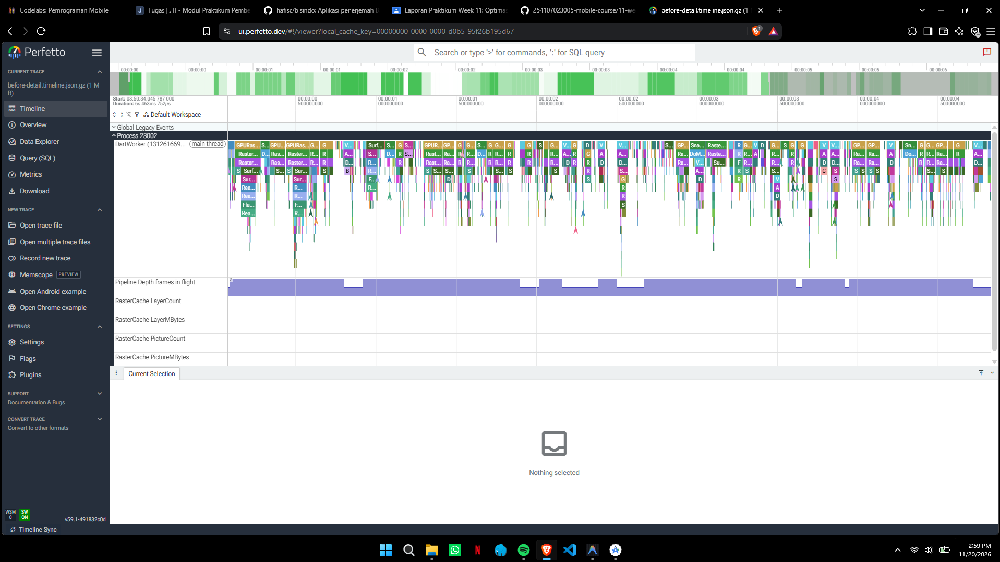
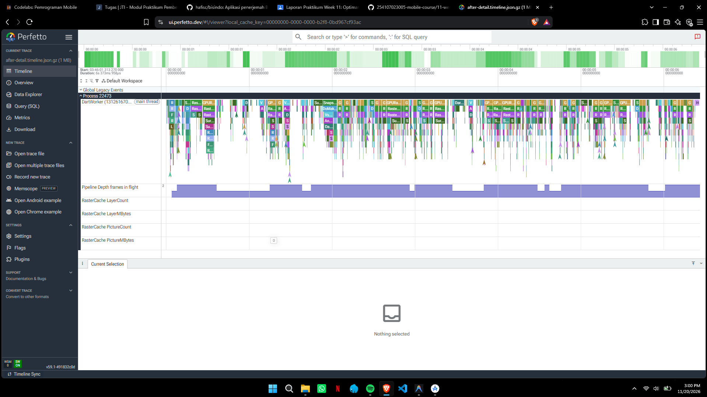

# Catatan Perf - Week 11: Optimasi Performa

Optimasi performa aplikasi **Catatan Offline + Asisten AI** dari Week 10, diuji dengan **2.000 catatan** di emulator dalam mode **profile**. Setiap optimasi berawal dari temuan profiling, lalu diukur ulang dengan skenario yang sama.

- Laporan lengkap: [`docs/performance-report.md`](docs/performance-report.md)
- Temuan profiling: [`docs/performance-findings.md`](docs/performance-findings.md)
- Refleksi: [`docs/refleksi.md`](docs/refleksi.md)
- Data mentah: [`docs/profiling/`](docs/profiling/)

---

## 📉 Hasil Utama

| Metrik | Sebelum | Sesudah |
|---|---|---|
| Query halaman detail (di perangkat) | ~35 ms | **3,9 ms** |
| Waktu GC skenario detail | 78,5 ms | **24,9 ms** |
| Build p90 skenario detail | 62,3 ms | **48,4 ms** |
| Rebuild saat mengetik `belanja` (`NotesPage` / `AppBar` / `NoteTile`) | 7 / 7 / 77 | **0 / 0 / 11** |
| Filter per ketikan (2.000 catatan) | 0,93 ms, 7x | **0,55 ms, 1x** (debounce) |
| Request jaringan, halaman posts dibuka 5x | 5 | **1** |
| Payload posts | 27.520 byte | **2.726 byte** |
| Objek bocor setelah navigasi 5x | 2 (`GoRouter`) | **0** |

**Yang tidak membaik:** frame time skenario search (ongkos filter sejak awal < 1 ms) dan raster jank (keterbatasan GPU emulator). Penjelasannya ada di laporan, bagian 4.

---

## 🛠️ Optimasi yang Diterapkan

1. **Ekstrak widget + Riverpod `select`**: `NotesPage` tidak lagi `watch` provider apa pun. Badge, kolom search, dan list menjadi widget terpisah.
2. **Debounce search 250 ms**.
3. **Indeks pencarian**: huruf kecil dihitung sekali per perubahan data, hasilnya dibuktikan identik dengan filter lama.
4. **Query detail `WHERE id = ?`**, bukan memuat 2.000 baris.
5. **Stale-while-revalidate yang benar** untuk posts: satu `Dio`, throttle 5 menit, `?_limit=10`, UI ikut diperbarui.
6. **`dispose()` yang benar**: `GoRouter` dan `Timer` debounce.

---

## 🧪 Bukti Mesin Hijau

```bash
dart format --output=none --set-exit-if-changed lib test integration_test test_driver tool
# Formatted 46 files (0 changed)

flutter analyze --fatal-infos
# No issues found!

flutter test
# 00:29 +58: All tests passed!
```

| Test baru Week 11 | Isi |
|---|---|
| `test/rebuild_count_test.dart` | Jumlah rebuild per widget saat mengetik, dengan batas regresi |
| `test/search_index_test.dart` | Indeks pencarian = hasil `filterNotes` lama (9 kasus) |
| `test/posts_repository_test.dart` | Throttle request, `_limit`, offline, stale-while-revalidate |
| `test/leak/memory_leak_test.dart` | Leak tracker: navigasi 5x, debounce dibatalkan saat dispose |
| `integration_test/perf_test.dart` | Skenario profiling (perangkat, mode profile) |
| `integration_test/bench_test.dart` | Micro-benchmark lama vs baru di perangkat |

---

## 📱 Screenshot

| Sebelum | Sesudah |
|---|---|
|  |  |

Flame chart skenario detail. Trace aslinya ada di `docs/profiling/timeline/` dan bisa dibuka di [ui.perfetto.dev](https://ui.perfetto.dev).

---

## 🏃 Cara Menjalankan

```bash
cd 11-week-11-performance-optimization
flutter pub get
flutter test

# Profiling di emulator/HP (mode profile, mengisi 2.000 catatan):
flutter drive --profile --no-dds --driver=test_driver/perf_driver.dart \
  --target=integration_test/perf_test.dart -d <device-id>
dart run tool/perf_report.dart build

# Micro-benchmark lama vs baru:
flutter drive --profile --no-dds --driver=test_driver/perf_driver.dart \
  --target=integration_test/bench_test.dart -d <device-id>
```

> `--no-dds` wajib: tanpa opsi ini `traceAction` gagal terhubung ke VM Service.

---

## 👤 Informasi Mahasiswa

- **Nama**: Hafis
- **NIM**: 254107023005
- **Mata Kuliah**: Pemrograman Mobile (Semester 5)
- **Jurusan**: Teknologi Informasi - Politeknik Negeri Malang
